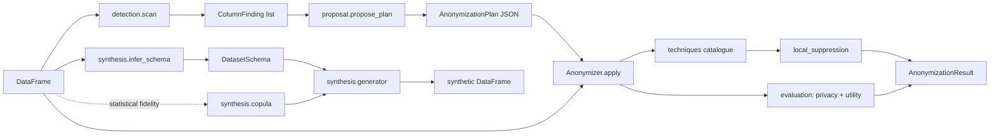

# Architecture

This document is the map of the code. Read it before your first change.

## Bird's-eye view

A pandas DataFrame comes in, and the main path runs in four steps:
1. The detector classifies each column.
2. The proposal turns the findings into an editable plan, for a protection target
   (pseudonymization or anonymization) and a fidelity (statistical or privacy).
3. The anonymizer runs the plan's techniques column by column, and optionally enforces
   k-anonymity.
4. It measures privacy, statistical drift and the protection level reached.

Beside that path:
- The noise explorer sweeps noise techniques over one column and renders an interactive
  page.
- The synthesis package generates tables from a schema with planted patterns, or learned
  from a reference table, and can wrap a schema's question into a data-science challenge.

Everything is in-process and pure pandas/numpy. The only file I/O is in `table_files.py`,
`noise_explorer/page.py` and `cli.py`.

## Code map

| Module | What lives here | What must not live here |
|---|---|---|
| `taxonomy.py` | `ColumnKind`, `DataCategory`, `Sensitivity` and the category-to-sensitivity table | Logic that looks at data |
| `detection/` | `checksums.py` (check-digit and structure rules per identifier), `patterns.py` (recognizers: pattern, checksum, free-text and name-hint flags), `column_names.py` (name hints and negative hints, EN/PT), `value_evidence.py` (scores every recognizer on a sample and picks the best fit, flagging ties), `kinds.py` (storage kind of a column), `detector.py` (`scan`, `ColumnFinding`, fallbacks) | Decisions about what to do with a column |
| `surrogates.py` | `SurrogateFactory`: realistic fake values per category, seeded for consistency | Anything about plans |
| `techniques/` | One module per family (`masking`, `pseudonymization`, `encryption`, `generalization`, `noise`, `perturbation`). `ff1.py` is the FF1 cipher that `encryption` uses. `value_mapping.py` applies a text transform to present or distinct values. `catalogue.py` registers every technique as a `Technique`, with an `inverse` for reversible ones. `context.py` holds the RNG, the secret key, HKDF key derivation and fakers | Table-level logic; techniques see one column |
| `plan.py` | `Fidelity`, `Protection`, `ColumnAction`, `AnonymizationPlan` (pydantic, JSON round-trip) | Rules for choosing techniques |
| `proposal.py` | `_direct_identifier_rule`, the attribute rule table with its anonymization overrides, and `propose_plan` | Applying techniques |
| `protection.py` | `assess_protection`: the level an applied plan reached (anonymized, at_risk, pseudonymized, identifiable), from the record isolation, linkage and inference checks | Changing data |
| `local_suppression.py` | `enforce_k_anonymity`: blanks quasi-identifiers in rows of small groups | Measuring privacy |
| `evaluation/` | `privacy.py` (k-anonymity, l-diversity), `utility.py` (mean/std change, KS, total variation, correlation change), `disclosure.py` (record linkage, interval disclosure and per-record shift for a noisy column) | Changing data |
| `noise_explorer/` | `sweep.py` (runs noise techniques at increasing strengths and measures each), `page.py` and `template.html` (the self-contained interactive page) | Noise algorithms; they come from `techniques/` |
| `synthesis/` | `schema.py` (`DatasetSchema`, columns, overrides, correlations, constraints, `Question`), `expressions.py` (the safe expression language), `marginals.py` (inverse distribution functions), `patterns.py` (conditions, formulas, outliers, exact statistics, gaps), `generator.py` (the four-step build and constraint filtering), `unique_values.py` (unique integer keys and templates), `copula.py` (Gaussian copula learned from a reference, optionally per level), `latent_correlation.py` (correlation of the hidden normal variables behind categories and numbers), `inference.py` (schema from a table), `challenge.py` (train/test split and answer key) | Detection rules; it calls `detection.scan` |
| `anonymizer.py` | `Anonymizer`, the facade that wires the above together (`scan`, `propose`, `apply`, `reveal`, `synthesize`, `challenge`), and `AnonymizationResult` | Rules; it only orchestrates |
| `table_files.py` | Read and write CSV or Parquet by extension | Anything else |
| `cli.py` | The `anonymize` command; reads `ANONYMIZER_SECRET_KEY` | Logic beyond parsing arguments and printing |

## Data flow

## Rules that must hold

- A technique receives one column and a `TechniqueContext`, and returns a new column of
  the same length and index. It never mutates its input.
- Missing values stay missing through every technique except `suppress`, which blanks
  every cell, and `shuffle`, which moves them between rows.
- All randomness comes from `context.rng` or the generator passed in, so `seed` reproduces
  a run. All pseudonyms and keyed salts come from `context.keyed_digest`, and all encryption
  keys from `context.derived_key`, so `secret_key` reproduces them. Cryptographic nonces and
  random salts come from `os.urandom`, never from the seeded generator.
- A reversible technique's inverse accepts the same parameters as the technique, so one
  plan drives both `apply` and `reveal`.
- Synthesis never copies a direct identifier from a reference table. Identifier columns
  get fake values or fresh unique numbers.
- Schema expressions are parsed with `ast` and evaluated node by node, never with `eval`.
  Random functions are allowed only in formulas, so conditions and constraints give the
  same answer every time they are checked.
- An anonymization plan never runs a technique whose `keeps_link` is true, and it runs
  under a throwaway key.
- The library never reads environment variables or configures logging. The CLI does.

## Cross-cutting concerns

- **Errors**: `errors.py`. `PlanError` for plans, `SchemaError` for schemas,
  `TableFormatError` for file types. All inherit from `AnonymizerError`. The CLI turns them
  into exit code 2, and uses exit code 3 when `apply` misses the plan's protection target.
- **Validation**: plans and schemas are pydantic models validated on load. A plan is also
  checked against the table (columns, techniques, parameter names) before anything runs.
- **Logging**: the package logger has a `NullHandler`. Applications configure logging.
- **Testing**: `tests/` uses a shared `people` fixture (`conftest.py`) with Brazilian
  and generic personal data. Techniques are tested as pure functions, and the facade and
  CLI end to end.

## Where to change things

| To change | Go to |
|---|---|
| What the proposal suggests for a category | `_ATTRIBUTE_RULES` and `_ANONYMIZATION_RULES` in `proposal.py`; direct identifiers in `_direct_identifier_rule` |
| A new kind of personal data | `DataCategory` in `taxonomy.py`; a check in `detection/checksums.py` and a recognizer in `detection/patterns.py`, or a hint in `detection/column_names.py`; a generator in `surrogates.py` if fakes are needed; `docs/detection.md` |
| A new technique | a function in the matching `techniques/<family>.py` and a `Technique` entry in `techniques/catalogue.py` (`inverse=` when reversible, `linkable=True` when its output can be tied back to a person); `docs/techniques.md` |
| A protection check | `protection.py` and `docs/protection.md` |
| A privacy, utility or disclosure metric | `evaluation/` |
| What the noise explorer sweeps or shows | `DEFAULT_SWEEPS` in `noise_explorer/sweep.py`; `noise_explorer/template.html` |
| A distribution, pattern or expression function for synthesis | `synthesis/marginals.py`, `synthesis/patterns.py`, `synthesis/expressions.py`, and `docs/synthesis.md` |
| A CLI command or flag | `cli.py` and the README command table |
