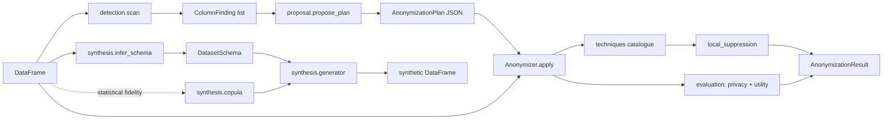

# Architecture

This document is the map of the code. Read it before your first change.

## Bird's-eye view

A pandas DataFrame comes in. The detector classifies each column. The proposal turns the
findings into an editable plan. The anonymizer runs the plan's techniques column by
column, optionally enforces k-anonymity, and measures privacy and statistical drift.
Separately, the synthesis package generates new tables from a schema, or from a schema
plus a reference table. Everything is in-process and pure pandas/numpy. The only I/O is
in `table_files.py` and `cli.py`.

## Code map

| Module | What lives here | What must not live here |
|---|---|---|
| `taxonomy.py` | `ColumnKind`, `DataCategory`, `Sensitivity` and the category-to-sensitivity table | Logic that looks at data |
| `detection/` | `patterns.py` (value recognizers and checksum validators), `column_names.py` (name hints, EN/PT), `kinds.py` (storage kind of a column), `detector.py` (`scan`, `ColumnFinding`) | Decisions about what to do with a column |
| `surrogates.py` | `SurrogateFactory`: realistic fake values per category, seeded for consistency | Anything about plans |
| `techniques/` | One module per family (`masking`, `pseudonymization`, `encryption`, `generalization`, `noise`, `perturbation`). `ff1.py` is the FF1 cipher that `encryption` uses. `value_mapping.py` applies a text transform to present or distinct values. `catalogue.py` registers every technique as a `Technique`, with an `inverse` for reversible ones. `context.py` holds the RNG, the secret key, HKDF key derivation and fakers | Table-level logic; techniques see one column |
| `plan.py` | `Fidelity`, `ColumnAction`, `AnonymizationPlan` (pydantic, JSON round-trip) | Rules for choosing techniques |
| `proposal.py` | The category × fidelity rule table and `propose_plan` | Applying techniques |
| `local_suppression.py` | `enforce_k_anonymity`: blanks quasi-identifiers in rows of small groups | Measuring privacy |
| `evaluation/` | `privacy.py` (k-anonymity, l-diversity), `utility.py` (mean/std change, KS, total variation, correlation change) | Changing data |
| `synthesis/` | `schema.py` (`DatasetSchema`), `inference.py` (schema from a table), `copula.py` (Gaussian copula), `generator.py` (schema-only and reference-based generation) | Detection rules; it calls `detection.scan` |
| `anonymizer.py` | `Anonymizer`, the facade that wires the above together (`scan`, `propose`, `apply`, `reveal`, `synthesize`), and `AnonymizationResult` | Rules; it only orchestrates |
| `table_files.py` | Read and write CSV or Parquet by extension | Anything else |
| `cli.py` | The `anonymize` command; reads `ANONYMIZER_SECRET_KEY` | Logic beyond parsing arguments and printing |

## Data flow

## Rules that must hold

- A technique receives one column and a `TechniqueContext`, and returns a new column of
  the same length and index. It never mutates its input.
- Missing values stay missing through every technique except `suppress`, which blanks
  every cell, and `shuffle`, which moves them between rows.
- All randomness comes from `context.rng` or the generator passed in, so `seed` reproduces
  a run. All pseudonyms and keyed salts come from `context.keyed_digest`, and all encryption
  keys from `context.derived_key`, so `secret_key` reproduces them. Cryptographic nonces and
  random salts come from `os.urandom`, never from the seeded generator.
- A reversible technique's inverse accepts the same parameters as the technique, so one
  plan drives both `apply` and `reveal`.
- Synthesis never copies a direct identifier from a reference table. Identifier columns
  get fake values or fresh unique numbers.
- The library never reads environment variables or configures logging. The CLI does.

## Cross-cutting concerns

- **Errors**: `errors.py`. `PlanError` for plans, `SchemaError` for schemas,
  `TableFormatError` for file types. All inherit from `AnonymizerError`. The CLI turns them
  into exit code 2.
- **Validation**: plans and schemas are pydantic models validated on load. A plan is also
  checked against the table (columns, techniques, parameter names) before anything runs.
- **Logging**: the package logger has a `NullHandler`. Applications configure logging.
- **Testing**: `tests/` uses a shared `people` fixture (`conftest.py`) with Brazilian
  and generic personal data. Techniques are tested as pure functions, and the facade and
  CLI end to end.

## Where to change things

| To change | Go to |
|---|---|
| What the proposal suggests for a category | the `_RULES` table in `proposal.py` |
| A new kind of personal data | `DataCategory` in `taxonomy.py`, a recognizer in `detection/patterns.py` and/or a hint in `detection/column_names.py`, a generator in `surrogates.py`, a rule in `proposal.py` |
| A new technique | a function in the matching `techniques/<family>.py` and a `Technique` entry in `techniques/catalogue.py` (with `inverse=` when it is reversible); add it to the README table |
| A new privacy or utility metric | `evaluation/` |
| How synthetic columns are drawn | `synthesis/generator.py` (schema) or `synthesis/copula.py` (reference) |
| A CLI command or flag | `cli.py` and the README usage table |
