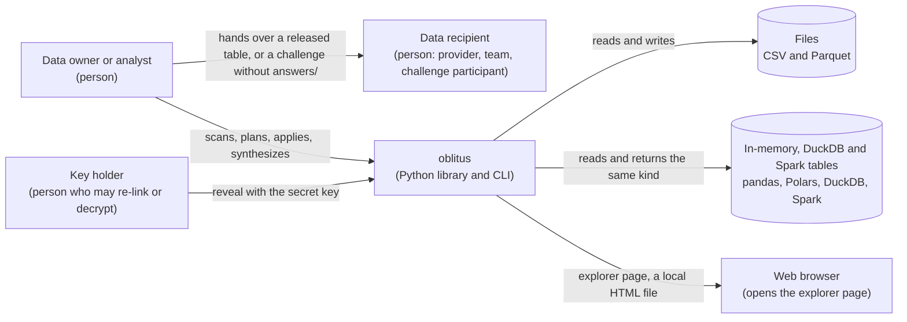
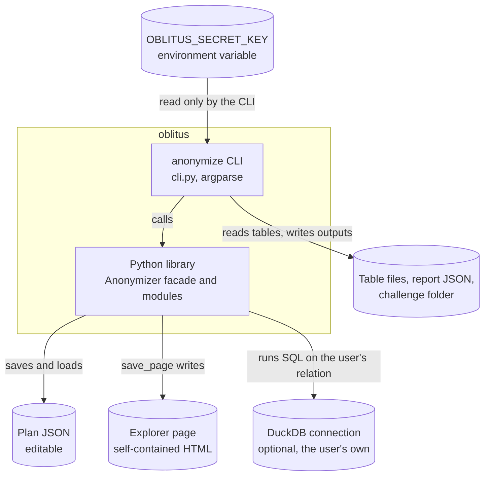
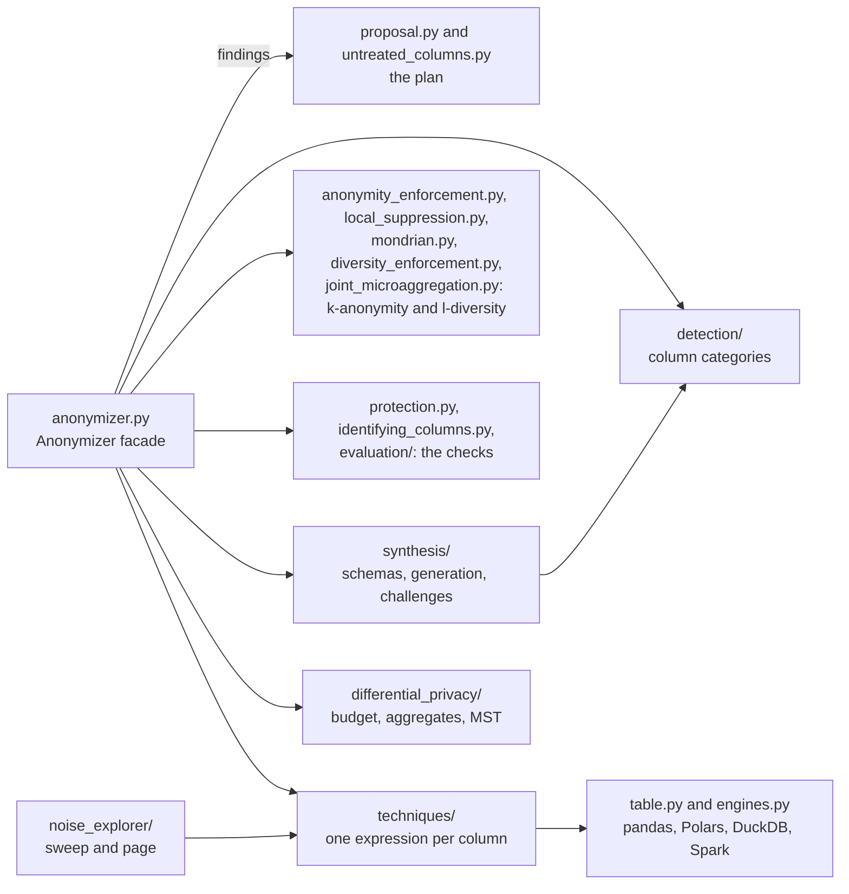
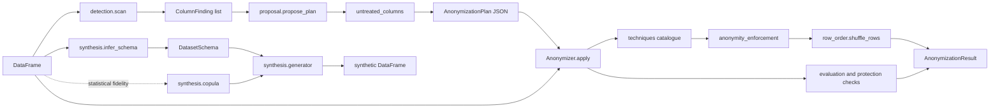

# Architecture

This document is the map of the code. Read it before your first change.

## Bird's-eye view

A pandas, Polars, DuckDB or Spark table comes in, and the main path runs in four steps:
1. The detector classifies each column.
2. The proposal turns the findings into an editable plan, for a protection target
   (pseudonymization or anonymization) and a fidelity (statistical or privacy).
3. The anonymizer runs the plan's techniques column by column, and optionally enforces
   k-anonymity.
4. It measures privacy, statistical drift and the protection level reached.

Beside that path:
- The noise explorer sweeps noise techniques over one column and renders an interactive
  page.
- The synthesis package generates tables from a schema with planted patterns, or learned
  from a reference table, and can wrap a schema's question into a data-science challenge.

Everything is in-process. The only file I/O is in `table_files.py`,
`noise_explorer/page.py`, `cli.py`, `token_vault.py` (the SQLite vault), `table_manifest.py`,
and the JSON `save` and `load` of `plan.py` and `synthesis/schema.py`.

## System views (C4-style)

These three views follow the C4 model's levels, drawn as plain Mermaid flowcharts. They show
the system as it is: a library and a command line that run inside the user's own process,
with no service, database or network call of their own.

### Level 1: system context

Who uses oblitus, and what it touches.

- The data owner runs every step and decides what leaves their machine. The library sends
  nothing anywhere.
- The recipient gets only what the owner hands over: a released table, a challenge folder
  without its `answers/`, or a synthetic table.
- The key holder can re-link pseudonyms and decrypt reversible columns. Under anonymization,
  pseudonyms, encryption, codes and fakes use a throwaway key, so nobody can re-link them, but
  the secret key still drives the noise. Its holder can reproduce that noise, so the key stays
  secret.

### Level 2: containers

The runnable parts and the data they produce.

- The CLI parses arguments, reads the key from the environment, reads and writes the table
  files, reports and challenge folders, and prints results. The library never reads
  environment variables.
- On a DuckDB relation the library builds lazy queries on the user's own connection, so a
  large table stays in DuckDB until the result is collected. A Spark DataFrame is handled the
  same way, on the user's own Spark session.

### Level 3: components of the library

The code map below names every module and what must not live in it.

## Code map

| Module | What lives here | What must not live here |
|---|---|---|
| `taxonomy.py` | `ColumnKind`, `DataCategory`, `Sensitivity` and the category-to-sensitivity table | Logic that looks at data |
| `detection/` | `checksums.py` (check-digit and structure rules per identifier), `identifier_boundaries.py` (pattern edges that treat underscores as separators), `patterns.py` (recognizers: pattern, checksum, strong-check, free-text and name-hint flags), `column_names.py` (name hints, qualifier words and negative hints, EN/PT), `missing_values.py` (placeholder text that counts as missing), `value_evidence.py` (scores every recognizer on a sample and picks the best fit, flagging ties and mixed columns), `person_names.py` (do values look like names, and do they start with a known first name), `reference_lists.py` (the bundled IBGE first-name, surname and municipality lists in `detection/data/`), `place_names.py` (is a value a municipality), `crypto_wallets.py` (Bitcoin and Ethereum address checksums, with Keccak-256), `passport_mrz.py` (passport machine-readable zone and its check digits), `international_identifiers.py` (optional `python-stdnum` and `phonenumbers` checks, imported on first use), `named_entities.py` (names and addresses in text from an optional GLiNER or Presidio model, loaded only when asked for), `calibration.py` (maps the raw confidence to a calibrated one with constants fitted on the benchmark), `text_normalization.py` (NFKC, hidden characters, look-alikes and `[at]` undone, with the original position of each character), `text_names.py` (person names and cities in prose, from the bundled lists), `text_entities.py` (personal data inside text, found on the normalized copy and mapped back, for redaction and the residue check), `free_text.py` (prose that embeds personal data), `kinds.py` (storage kind of a column and which kinds can hold a category), `detector.py` (`scan`, `ColumnFinding`, fallbacks) | Decisions about what to do with a column |
| `benchmarks/` | The labelled detection benchmark (`detection_benchmark.py`), the script that refits the confidence calibration (`calibrate_detection.py`) and the script that rebuilds the IBGE lists (`build_reference_lists.py`). Developer tools, not shipped in the wheel | Library code |
| `table.py` | `Table`: the table a plan is applied to, on any engine. Techniques read and replace columns through it: statistics, distinct values, keyed uniforms per row or entity, lookups of values computed in Python, reordering values, and each column's original values | Engine-specific code |
| `engines.py` | Everything that differs between pandas, Polars, DuckDB and Spark: converting frames in and out, keyed uniforms from SHA-256 (Python, DuckDB SQL or Spark `sha2`), and lookup tables built on the data's own connection or session | Technique logic |
| `surrogates.py` | `SurrogateFactory`: realistic fake values per category, seeded for consistency | Anything about plans |
| `techniques/` | One module per family (`masking`, `pseudonymization`, `encryption`, `generalization`, `rescaling`, `noise`, `perturbation`). Each technique is `(table, column, context, **params) -> Narwhals expression`, so one implementation runs on every engine. `ff1.py` is the FF1 cipher that `encryption` uses. `numeric_expressions.py` and `date_expressions.py` hold shared expression pieces (Box–Muller and Laplace noise, integer round-trips, day shifts). `tokenization.py` swaps values for random tokens kept in a vault. `value_mapping.py` runs a Python text transform per distinct value or per row and joins the results back. `catalogue.py` registers every technique as a `Technique`, with an `inverse` for reversible ones. `context.py` holds the secret key, the optional token vault, the randomness key with one derived key per column and purpose, HKDF key derivation and fakers | Table-level logic; techniques see one column |
| `token_vault.py` | `TokenVault` (the interface tokenization needs), `MemoryVault`, and `SqliteVault`, a SQLite file created readable by its owner only. The caller passes a vault to `apply` and `reveal`; a plan never holds one | Choosing tokens; techniques decide that |
| `joined_tables.py` | `joined_table_problems`: joins the released tables of one `apply_many` call on columns they code consistently and checks k-anonymity and inference over entities | Applying plans |
| `table_manifest.py` | `TableManifest`: the JSON file `apply-many` reads, listing each table's input, output and plan | Applying plans |
| `plan.py` | `Fidelity`, `Protection`, `ColumnAction`, `AnonymizationPlan` (pydantic, JSON round-trip) | Rules for choosing techniques |
| `proposal.py` | `_direct_identifier_rule`, the attribute rule table with its anonymization overrides, and `propose_plan` | Applying techniques |
| `protection.py` | `assess_protection`: the level an applied plan reached (anonymized, at_risk, pseudonymized, identifiable), from the record isolation, linkage and inference checks, run on the released data | Changing data |
| `identifying_columns.py` | Released columns that single out rows or link an entity's rows: fingerprints and untreated entity keys (single or paired columns), counted on the whole table | Changing data |
| `untreated_columns.py` | `treat_untreated_columns`: under anonymization, completes a proposed plan from the whole table's values (fresh codes for text keys, generalized fingerprint timestamps and numbers, low-cardinality columns as quasi-identifiers) | Applying techniques |
| `row_order.py` | `shuffle_rows`: the fresh random row order of an anonymized release | Measuring privacy |
| `anonymity_enforcement.py` | `enforce_plan_targets`: runs the plan's table-level steps on the released table, in order: joint microaggregation, k-anonymity (local suppression or Mondrian), l-diversity | The algorithms; it only decides which run |
| `mondrian.py` | `enforce_k_anonymity_by_mondrian`: strict Mondrian partitioning on the distinct quasi-identifier combinations, and the write-back of each group's description | Measuring privacy |
| `generalized_column.py` | `GeneralizedColumn`: one quasi-identifier column's order, relative width and group description (bounding cuts, median, set or hierarchy ancestor) | Choosing cuts |
| `generalization_hierarchies.py` | `GeneralizationHierarchy`: levels or prefix lengths that make a value coarser, and the built-in `cep` preset | Applying a level to a column; that is the `generalize_hierarchy` technique |
| `joint_microaggregation.py` | `microaggregate_jointly`: MDAV groups over several numeric columns, replaced by group means | Single-column microaggregation; that is a technique |
| `diversity_enforcement.py` | `enforce_l_diversity`: blanks groups with too few sensitive values and merges them, on the whole table in its engine | Measuring privacy |
| `group_rewrite.py` | `distinct_rows` and `overwrite_by_key`: the distinct combinations of columns with their counts, and new values written back to the rows that match a key, on the table's engine | Deciding what the new values are |
| `local_suppression.py` | `enforce_k_anonymity`: blanks quasi-identifiers in rows of small groups, and the smallest complete group when blank rows stay below k, on the whole table in its engine | Measuring privacy |
| `evaluation/` | `privacy.py` (k-anonymity, l-diversity, t-closeness, on the whole table), `attacks.py` (Anonymeter singling-out, linkability and inference attacks, behind the optional `anonymeter` extra), `aligned_sample.py` (the same at most 200,000 rows of the original and released table, as pandas, for the checks below; `SampleAccumulator` builds it from chunks), `utility.py` (mean/std change, KS, total variation, correlation change), `disclosure.py` (record linkage, joint linkage over several columns, interval disclosure and per-record shift for a noisy column), `inference.py` (groups in which one sensitive value can be guessed with high confidence above its base rate), `dominance.py` (whether a released number still reveals a segment's dominant contributor), `record_distance.py` (Gower-like distance to the nearest records of another table, in chunks), `isolated_records.py` (near and partial copies of the most isolated training records, and the chance level from the holdout), `synthetic_privacy.py` (exact copies, copies of isolated records, DCR share and a membership-inference attack on a synthetic table, and the verdict) | Changing data |
| `noise_explorer/` | `sweep.py` (runs noise techniques at increasing strengths and measures each), `page.py` and `template.html` (the self-contained interactive page) | Noise algorithms; they come from `techniques/` |
| `synthesis/` | `schema.py` (`DatasetSchema`, columns, overrides, correlations, constraints, `Question`), `expressions.py` (the safe expression language), `marginals.py` (inverse distribution functions), `patterns.py` (conditions, formulas, outliers, exact statistics, gaps), `generator.py` (the four-step build and constraint filtering), `column_values.py` (the values of one column: uniforms, draw or formula, conditions, outliers), `panel.py` (a panel's settings, row layout, column levels and lags of a finished table), `panel_generation.py` (builds a panel period by period), `time_series.py` (the `time_series` section of an answer key), `draw_replay.py` (the uniform numbers behind every row, stored with it so a build can be replayed), `causal_graph.py` (the graph a schema declares, column roles and back-door adjustment sets), `interventions.py` (`do(treatment = value)` by replaying the stored numbers), `treatment_effects.py` (the `causal` section of an answer key), `unique_values.py` (unique integer keys and templates), `copula.py` (Gaussian copula learned from a reference, optionally per level), `latent_correlation.py` (correlation of the hidden normal variables behind categories and numbers), `inference.py` (schema from a table), `rare_values.py` (merges rare categories and pulls in extreme numbers so one record cannot reappear), `challenge.py` (train/test split, answer key and leakage flags), `drift.py` (shifted test rows and drift kind), `label_noise.py` (flipped or perturbed labels), `logistic_calibration.py` (shifts probabilities on the log-odds scale to a mean), `class_balance.py` (a question's positive share and the imbalance section of the key), `missingness.py` (MAR and MNAR blank cells and the key's account of them), `difficulty.py` (easy, medium and hard as concrete settings), `relational.py` (a schema of tables joined by foreign keys, child counts and aggregates), `relational_generation.py` (builds the tables parent first), `relational_challenge.py` (a challenge whose target is in the root table), `question_text.py` (the participants' task description, written without the answer key) | Detection rules; it calls `detection.scan` |
| `key_generation.py`, `entropy_sources.py` | `generate_key`: mixes `os.urandom` (always) with extra entropy sources through HKDF, health-checks physical samples and reports each source. `entropy_sources.py` holds the built-in readers (hardware RNG, microphone, camera, CPU jitter, beacons) | Anything about plans or techniques |
| `differential_privacy/` | `budget.py` (`PrivacyBudget`, `Spend`, `compose_budget`: the one place where epsilon and zCDP rho are added and a budget is refused), `domains.py` (public column domains: listed values or bounds and bins, to codes and back), `aggregates.py` (noisy counts, sums and means per group with OpenDP, imported lazily), `mst_synthesis.py` (MST: noisy one-way counts, exponential-mechanism tree, noisy pair counts), `tree_model.py` (consistent non-negative tree and row sampling from noisy counts) | Bounds or domains read from the data; reading tables from files |
| `anonymizer.py` | `Anonymizer`, the facade that wires the above together (`scan`, `propose`, `apply`, `apply_file`, `apply_many`, `reveal`, `synthesize`, `synthesize_tables`, `synthesize_private`, `check_synthetic`, `aggregate_private`, `challenge`), and `AnonymizationResult` | Rules; it only orchestrates |
| `table_files.py` | Read and write CSV or Parquet by extension, with Polars; read a file in chunks, write one chunk at a time, and scan a file lazily | Anything else |
| `chunked_apply.py` | `apply_in_chunks`: runs a plan on a file chunk by chunk, refuses what needs the whole column (`chunk_blockers`), and measures the written file lazily. `Anonymizer.apply_file` calls it | Techniques; it receives the per-chunk release as a function |
| `cli.py` | The `oblitus` command; reads `OBLITUS_SECRET_KEY` | Logic beyond parsing arguments and printing |

## Data flow

## Rules that must hold

- A technique receives one column and a `TechniqueContext`, and returns a new column of
  the same length and index. It never mutates its input.
- Missing values stay missing through every technique except `suppress`, which blanks
  every cell, and `shuffle`, which moves them between rows.
- Noise per row comes from keyed hashes of the row key (`context.stream_key`, computed by
  `engines.add_keyed_uniforms`), so the same row gets the same noise on every engine. Random
  choices that stand in for values, such as category codes and random fakes, use
  `context.choice_key` and `context.generator`. All pseudonyms and keyed salts come from
  `context.keyed_digest`, and all encryption keys from `context.derived_key`, so
  `secret_key` reproduces them. Cryptographic nonces, random salts and tokens come from
  `os.urandom`, never from a seeded generator.
- A reversible technique's inverse accepts the same parameters as the technique, so one
  plan drives both `apply` and `reveal`.
- Synthesis never copies a direct identifier from a reference table. Identifier columns
  get fake values or fresh unique numbers.
- Every random number used to build a schema row comes from a uniform number stored with
  the row (`draw_replay.py`), so an intervention can replay the build. Constraint filtering
  drops the numbers together with their rows.
- Schema expressions are parsed with `ast` and evaluated node by node, never with `eval`.
  Random functions are allowed only in formulas, so conditions and constraints give the
  same answer every time they are checked.
- An anonymization plan never runs a technique whose `keeps_link` is true, and it runs
  under a throwaway key. `apply_many` shares one throwaway key across the anonymizing tables
  of a call, and never across calls.
- A vault is passed in at `apply` and `reveal` time and never stored in a plan, so plans stay
  plain JSON.
- The library never reads environment variables or configures logging. The CLI does.

## Cross-cutting concerns

- **Errors**: `errors.py`. `PlanError` for plans, `SchemaError` for schemas, `PrivacyBudgetError` for budgets,
  `TableFormatError` for file types. All inherit from `AnonymizerError`. The CLI turns them
  into exit code 2, and uses exit code 3 when `apply` misses the plan's protection target.
- **Validation**: plans and schemas are pydantic models validated on load. A plan is also
  checked against the table (columns, techniques, parameter names) before anything runs.
- **Logging**: the package logger has a `NullHandler`. Applications configure logging.
- **Testing**: `tests/` uses a shared `people` fixture (`conftest.py`) with Brazilian
  and generic personal data. Techniques are tested as pure functions, and the facade and
  CLI end to end.

## Where to change things

| To change | Go to |
|---|---|
| What the proposal suggests for a category | `_ATTRIBUTE_RULES` and `_ANONYMIZATION_RULES` in `proposal.py`; direct identifiers in `_direct_identifier_rule` |
| A new kind of personal data | `DataCategory` in `taxonomy.py`; a check in `detection/checksums.py` and a recognizer in `detection/patterns.py`, or a hint in `detection/column_names.py`; a generator in `surrogates.py` if fakes are needed; `docs/detection.md`. After a change to detection rules, refit the confidence with `uv run python -m benchmarks.calibrate_detection` |
| A new technique | a function in the matching `techniques/<family>.py` and a `Technique` entry in `techniques/catalogue.py` (`inverse=` when reversible, `linkable=True` when its output can be tied back to a person); `docs/techniques.md` |
| A way to enforce k-anonymity or l-diversity | a module beside `mondrian.py`, chosen in `anonymity_enforcement.py` and a `KAnonymityMethod` value in `plan.py`; `docs/protection.md` |
| A protection check | `protection.py` and `docs/protection.md` |
| A privacy, utility or disclosure metric | `evaluation/` |
| What the noise explorer sweeps or shows | `DEFAULT_SWEEPS` in `noise_explorer/sweep.py`; `noise_explorer/template.html` |
| A distribution, pattern or expression function for synthesis | `synthesis/marginals.py`, `synthesis/patterns.py`, `synthesis/expressions.py`, and `docs/synthesis.md` |
| Differential privacy: a mechanism, its cost, or the budget split | `differential_privacy/`; the cost of every noisy step goes through `compose_budget`; `docs/differential-privacy.md` |
| A CLI command or flag | `cli.py` and the README command table |
