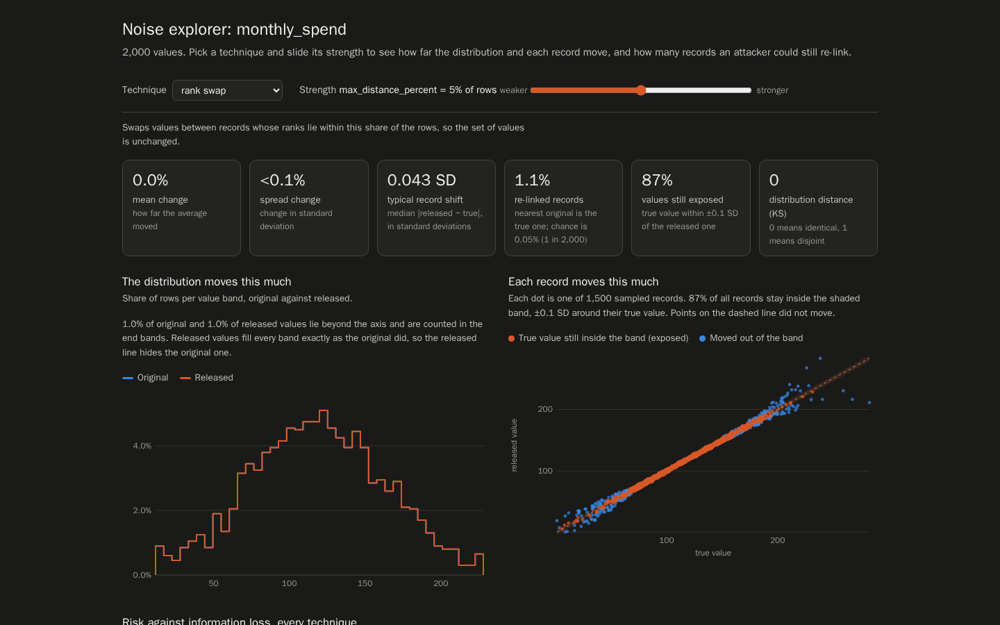
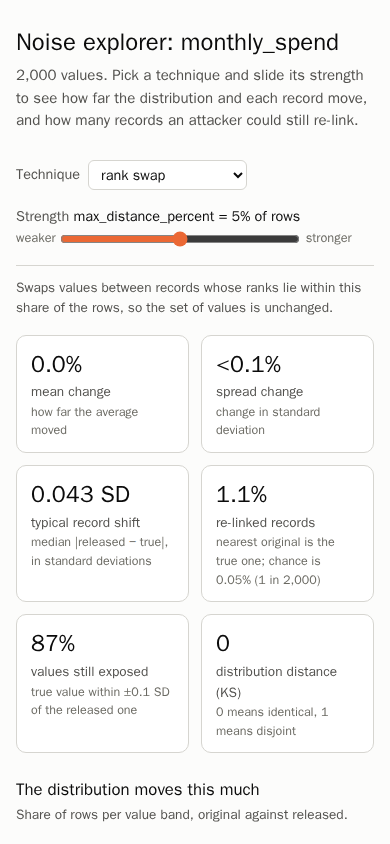

# Noise explorer

The noise explorer shows what each noise technique would do to one numeric column before you
put it in a plan. You write a page for the column, open it in a browser, and compare techniques
and strengths by how far records move against how many can still be re-linked.

## Write the page

From the command line, with a table that has a numeric column:

```bash
uv run oblitus explore-noise customers.csv --column monthly_spend -o monthly_spend_noise.html
```

It prints `wrote monthly_spend_noise.html; open it in a browser`. To try it without your own
data, first write a sample table from the example schema:

```bash
uv run oblitus synthesize --schema examples/customers_schema.json --rows 2000 -o customers.csv
```

From Python:

```python
from pathlib import Path

import pandas as pd

from oblitus.noise_explorer import explore_noise, save_page

customers = pd.read_csv("customers.csv")
exploration = explore_noise(customers, "monthly_spend", seed=1)
exploration.metrics  # one row per technique and strength
save_page(exploration, Path("monthly_spend_noise.html"))
```

## Open the page

The page is a single HTML file. It needs no server and no network, so open it like any local
file, in a current Chrome, Edge, Firefox or Safari:

| System | Command |
|---|---|
| Linux | `xdg-open monthly_spend_noise.html` |
| macOS | `open monthly_spend_noise.html` |
| Windows (PowerShell or cmd) | `start monthly_spend_noise.html` |
| WSL | `explorer.exe "$(wslpath -w monthly_spend_noise.html)"` |

Double-clicking the file in a file manager works too, as does dragging it onto a browser
window. The page follows the system's light or dark theme, and stacks its tiles and charts on
a phone-width window.





**The page holds real values.** It embeds histograms of the column and up to 1,500 of its
original values, for the per-record chart. Treat the file like the original table: keep it
where the data may be, and do not attach it to a ticket, chat or public repository.

## What the page runs

It runs every noise technique on the column at several strengths:

| Technique | Plan parameter | Strengths, weakest to strongest |
|---|---|---|
| `gaussian_noise` | `relative_scale` | 0.02 to 1.5 |
| `multiplicative_noise` | `relative_scale` | 0.02 to 0.5 |
| `laplace_noise` | `epsilon`, plus `lower` and `upper` | 100 to 0.5 |
| `rank_swap` | `max_distance_percent` | 0.5 to 40 (% of the rows) |
| `microaggregate` | `group_size` | 2 to 50 |

A chosen setting goes into the plan as, for example:

```json
{"column": "monthly_spend", "technique": "rank_swap", "params": {"max_distance_percent": 5.0}}
```

Columns with more than 200,000 numeric values are explored on a random sample of that
size (`--max-rows` or `max_rows=` to change it); the page says so. The metrics are shares
and medians, which a sample this size estimates closely.

Pick a technique and slide its strength. Clicking a point on the risk map selects that
setting. From the keyboard, Tab reaches each chart: on the histogram the arrow keys read one
band at a time, and on the risk map Left and Right walk a technique's strengths, Up and Down
change technique, and Enter selects the point. A good setting sits low and to the left on the risk map: few re-linked records for
the shift you accept. Copy its technique and strength into the plan, as above. For
`laplace_noise`, also set `lower` and `upper` to bounds you choose without looking at the data:
the explorer used the column's own minimum and maximum, which a release must not reveal. The page
says so whenever `laplace_noise` is selected.

## What it shows


The screenshots use a synthetic `monthly_spend` column of 2,000 values, with `rank_swap` at 5%.

**Tiles**
- Mean change and spread change.
- Typical record shift: the median |released − true|, in standard deviations.
- Re-linked records, with the chance rate for comparison.
- Values still exposed.
- Kolmogorov–Smirnov distance.

**Charts**

*The distribution moves this much.* Original against released histogram, on one axis per
technique. The axis covers the middle 99% of the original and released values, so one extreme
outlier does not squash the rest. Values beyond it are counted in the end bands, whose labels
read "or less" and "or more", and a note gives their share. Rank swap only moves values between
records, so its released line lies exactly on the original one.


*Each record moves this much.* True against released value for up to 1,500 sampled records.
The shaded band is ±`--band` standard deviations (default 0.1). Points inside it, in orange,
are records whose true value an attacker can still pin down.


*Risk against information loss.* For every technique and strength, re-linked records (log
scale) against typical record shift (log scale). Lower and further left is better, the ring
marks the selected setting, and the dashed line is chance. Each technique has its own
marker shape, so the lines can be told apart without colour. A log scale has no zero, so
settings with no re-linked records or no shift sit on the edge of the axis; its tick reads 0
only when such settings exist.


The same column with `gaussian_noise` at its strongest setting: the histograms now differ a
little, records scatter far from the diagonal, and only 8.2% stay exposed.


**Table**: every strength of the selected technique, with all metrics.

## The metrics

| Metric | Meaning |
|---|---|
| Re-linked records | Share of released values whose nearest original value belongs to the same record (distance-based record linkage). Ties split the credit, so microaggregation with groups of k scores 1/k. Chance is 1 / rows |
| Values still exposed | Share of records whose true value lies within ±band standard deviations of the released value (interval disclosure) |
| Typical / 95th percentile shift | How far records moved, in standard deviations |
| Wasserstein / IQR | Distance between the distributions, in units of the original interquartile range |
| KS | Kolmogorov–Smirnov statistic: 0 means identical distributions, 1 disjoint |

The same linkage measure decides the anonymization check for noisy columns: re-linking
more than 1 record in `k_target` fails it.
